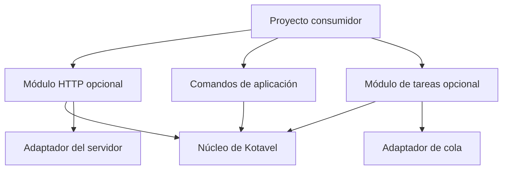

# Blueprint propuesto de Kotavel

**Kotavel puede combinar la facilidad de desarrollo de Laravel con un runtime eficiente en C++.** Para conseguirlo, debemos diseñar primero una base que permita añadir capacidades sin rehacer el framework. El rendimiento es una prioridad de diseño y debe demostrarse con mediciones reproducibles, junto con corrección y estabilidad.

Este documento describe la arquitectura objetivo. Existe una primera implementación estática de `Kotavel::Core` con ciclo de vida síncrono, diagnóstico con ubicación/trazas, presentación por entorno y un contenedor explícito de servicios con providers. Las rutas API/web, middleware, deep links y un ciclo inicial desktop ya tienen implementación; el adaptador HTTP Drogon y el adaptador Qt Quick son opcionales. Consulta [Uso del núcleo](../core.md), [Contenedor de servicios](../container.md), [Rutas HTTP y deep links](../http.md) y [Aplicaciones de escritorio](../desktop.md). Persistencia sigue reservada. La asociación de deep links con el ejecutable y el control reiniciable de servicios desde desktop quedan pendientes. La implementación HTTP requiere validación nativa en Windows y Linux, pruebas de concurrencia y mediciones representativas antes de considerarse lista para producción. Cada `.cpp` se incorpora explícitamente a su target CMake.

La convención para identificar kernels, providers y componentes con prefijos de
framework o de proyecto está definida en [Convención de nombres](naming.md).
La propuesta de cachés, paquetes binarios, herramientas y publicación se
documenta en [Distribución y dependencias](distribution.md).
Ese documento también muestra un ejemplo de estructura interna de una
biblioteca y la separación entre sus contratos y métodos públicos, la lógica
común y los adaptadores de terceros.

**La continuidad controlada de la aplicación y la facilidad de depuración son requisitos fundamentales del núcleo.** Un fallo recuperable de una operación debe quedar aislado, con información suficiente para investigarlo y sin detener las demás operaciones. El rendimiento se evaluará junto con estos requisitos.

## Referencia de arquitectura

Laravel conecta sus componentes mediante un ciclo de arranque: carga la configuración, registra servicios y procesa solicitudes mediante middleware, rutas y controladores. Sus proveedores separan el registro de servicios de su inicialización. Esa separación puede orientar el diseño de Kotavel. [Ciclo de vida de Laravel](https://laravel.com/framework/docs/lifecycle).

| Pieza de Laravel | Qué aporta | Propuesta para Kotavel |
| --- | --- | --- |
| Application | Coordina el framework | Arranque, ejecución y cierre definidos |
| Service Container | Construye servicios y sus dependencias | Registro explícito con tipos y fábricas |
| Service Providers | Incorporan componentes | Módulos que registran servicios y luego los inicializan |
| Middleware | Procesamiento encadenado | Una cadena reutilizable cuando definamos HTTP |
| Contracts | Permiten cambiar implementaciones | Interfaces públicas pequeñas |
| Manejo de excepciones | Centraliza el reporte y la presentación de errores | Política central de errores y diagnóstico por operación |
| Artisan | Comandos de desarrollo y aplicación | Herramientas de desarrollo y comandos del consumidor |
| Base de datos, caché y colas | Funcionalidades listas para usar | Módulos opcionales con adaptadores |

El contenedor de Laravel puede resolver e inyectar dependencias y construir automáticamente determinadas clases. Kotavel comienza con fábricas, tipos y registros explícitos: muestran qué necesita cada servicio y no dependen de reflexión. La implementación inicial congela registros antes del boot, construye singletons bajo demanda y deja el cierre de proveedores en orden inverso. [Contenedor de Laravel](https://laravel.com/framework/docs/container).

## Núcleo pequeño y módulos opcionales

La responsabilidad del núcleo se limitaría a configuración, registro de servicios, ciclo de vida y errores. Los módulos de consola, HTTP, persistencia y tareas trabajarían sobre ese núcleo. Una aplicación debería compilar y ejecutar únicamente las capacidades que selecciona.



El diagrama muestra relaciones conceptuales. Los adaptadores implementarían contratos del módulo correspondiente. Las bibliotecas externas quedarían detrás de adaptadores cuando eso permita controlar la interfaz pública: el consumidor utilizaría tipos de Kotavel y los detalles del proveedor permanecerían dentro de la integración.

### Frontera de plataforma en el núcleo

Las diferencias del sistema operativo pertenecen a contratos pequeños de
`include/kotavel/contracts/` y a implementaciones bajo
`src/platform/<módulo>/<plataforma>/`. CMake
elige una implementación nativa por plataforma; el bootstrap la registra como
provider predeterminado. Los providers de la aplicación se registran antes y
pueden reemplazar esos defaults. El núcleo consume el contrato y no incluye
headers de Windows, POSIX, macOS ni Linux. Esta regla aplica al interior de
Kotavel; no obliga a las aplicaciones consumidoras a adoptar los adaptadores
internos ni cambia sus APIs.

La organización física agrupa primero por capacidad (`console`, `metrics`,
`networking`, `paths`, etc.) y luego por sistema (`windows`, `macos`, `linux` o
`posix` para implementaciones compartidas). Por ejemplo,
`src/platform/console/windows/console_output.cpp` contiene la salida UTF-8 de
Windows, mientras `src/platform/console/posix/console_output.cpp` implementa el
caso compartido POSIX.

Las fronteras implementadas incluyen `ProcessMetricsProvider`, que deja el
cálculo común de porcentajes separado de la lectura nativa; `SystemPaths`, que
resuelve carpetas de configuración, datos y caché; y `RuntimePathResolver`, que
ubica plugins, traducciones y certificados junto al ejecutable o dentro del
bundle. `PlatformServices` ofrece una vista agrupada sobre esos contratos. El
bootstrap registra cada adaptador nativo como default y compone el agregado;
los providers de aplicación pueden sustituir un contrato antes del registro de
defaults. Las referencias agrupadas pertenecen al contenedor y caducan con él.

La selección por sistema operativo se limita a `cmake/KotavelPlatform.cmake`,
que agrega los fuentes nativos correspondientes. El código C++ común no
contiene `#ifdef _WIN32`, `__APPLE__` ni ramas por sistema. Incluso la
información pública de `OS` proviene del adaptador compilado; no detecta la
plataforma con macros en una cabecera. Las diferencias de capacidades nativas
se resuelven mediante fuentes seleccionadas por CMake, no con preprocesador en
la implementación compartida. Los `#ifdef` de capacidades del compilador o de
símbolos disponibles se permiten cuando no representan una decisión de sistema
operativo.

El patrón se aplica donde hay una capacidad dependiente del sistema, no
forzando interfaces de plataforma en cada módulo:

| Módulo | Comportamiento común | Frontera de plataforma |
| --- | --- | --- |
| `foundation`, `container`, `config`, `env`, `text` | Ciclo de vida, servicios, configuración y textos | No necesitan adaptador propio; usan contratos comunes de otros módulos si hace falta. |
| `diagnostics` | Formato, reporte y registro | Hora UTC, trazas y lease de directorio se delegan a fuentes seleccionadas por CMake. |
| `console` | Arranque, ejecución y mensajes | Compone los providers y consulta `OS::key()` como dato; no selecciona código con ramas. |
| `metrics` | Cálculo y publicación de métricas | `ProcessMetricsProvider`, transporte local y PID tienen implementaciones nativas. |
| `http` | Rutas, requests, validación y respuestas | La resolución de host y el transporte nativo se delegan; la integración Drogon es un target opcional. |
| `desktop` | Ciclo de vida y contratos desktop | Qt está tras `Kotavel::DesktopQt`; su implementación es opcional y se enlaza aparte. |

Los contratos agrupan capacidades estables; no deben crecer como una interfaz
gigante que mezcle rutas, procesos, métricas, deep links y energía. Por ejemplo,
`ProcessManager`, `UrlSchemeRegistrar` y `PowerManager` solo se añadirán al
aparecer una API requerida y un comportamiento comprobable. El listado y la
organización detallados están en [Distribución y dependencias](distribution.md).

### Adaptadores de plataforma de la CLI

Los comandos de desarrollo siguen el mismo límite. `tools/kotavel_cli/platforms/`
contiene el contrato base, la implementación POSIX compartida y adaptadores de
Windows, Linux y macOS. `get_platform()` selecciona el adaptador al entrar a la
CLI; `install.py`, `deps.py`, `package.py` y `project_paths.py` delegan en él la
preparación del toolchain, rutas de herramientas, locks, activación de shell,
ejecución de bundles `.app` y soporte del empaquetador. Las diferencias entre
sistemas viven en esos adaptadores; los comandos no repiten condicionales por
sistema operativo.

Las pruebas del contrato y los casos específicos de macOS están en
`tests/test_platform_adapters.py`; se ejecutan junto con el resto de pruebas
Python mediante `python3 kotavel.py test --framework` desde el laboratorio.
Esta validación nativa prueba macOS arm64; no sustituye las ejecuciones en
Windows y Linux.

Los futuros targets podrían ser `Kotavel::Console`, `Kotavel::Events`, `Kotavel::Http`, `Kotavel::Database`, `Kotavel::Cache` y `Kotavel::Queue`. Solo `Kotavel::Core` existe hoy. Al implementarlos, sus opciones CMake y Conan deberán coincidir para que una dependencia opcional no se convierta en requisito obligatorio del núcleo.

## Estructura del repositorio

```text
Kotavel/
├── include/kotavel/
│   ├── foundation/       Aplicación, configuración, ciclo de vida y errores
│   ├── diagnostics/      Reporte de errores, contexto y depuración
│   ├── container/        Registro y construcción de servicios
│   ├── contracts/        Interfaces públicas pequeñas
│   ├── console/          Comandos del runtime consumidor
│   ├── events/           Eventos internos y suscripciones
│   ├── http/             Contratos HTTP futuros
│   ├── database/         Persistencia opcional
│   ├── cache/            Caché opcional
│   └── queue/            Trabajos y colas opcionales
├── src/                  Implementaciones de los módulos anteriores
├── adapters/             Integraciones concretas con proveedores externos
├── tools/kotavel_cli/    Herramientas Python de desarrollo existentes
├── templates/application/ Plantilla futura del proyecto consumidor
├── tests/                Pruebas existentes de herramientas
│   ├── unit/             Pruebas futuras de componentes C++
│   └── integration/      Pruebas futuras de consumo e integraciones
├── benchmarks/
│   └── baselines/        Referencias revisadas de rendimiento
├── examples/             Ejemplos mínimos futuros
├── docs/blueprint/        Esta propuesta
├── CMakeLists.txt
├── conanfile.py
├── pyproject.toml
├── LICENSE
└── README.md
```

`src/` reserva carpetas por módulo; `contracts/` permanece en las cabeceras mientras solo contenga interfaces. Los marcadores `.gitkeep` permiten versionar las carpetas vacías. No se generan targets ni se registran módulos automáticamente por crear estas carpetas.

Las herramientas Python pertenecen al framework. Cada consumidor conserva su configuración, receta, lockfile, perfiles y entrada `kotavel.py`. Los perfiles predeterminados ya empaquetados en `tools/kotavel_cli/templates/application/profiles/` siguen siendo recursos de las herramientas; `templates/application/` reserva la futura plantilla completa de una aplicación.

El Laboratorio ya utiliza `bootstrap/main.cpp` como entrada mínima,
`bootstrap/application.cpp` para conectar el runtime, `config/*.cpp` y
`config/app_config_files.cpp` para la configuración compilada y su registro para definir y registrar sus opciones.
El arranque pertenece al consumidor; el núcleo reutilizable permanece en Kotavel.

Como objetivo futuro, esa plantilla separaría `app/` para código propio, `bootstrap/` para arranque, `config/` para configuración y `tests/` para pruebas, además de sus archivos CMake, Conan y Kotavel. El consumidor podrá usar el framework desde una carpeta local o desde una versión publicada. La publicación remota y la generación de proyectos todavía deben implementarse.

## Arranque, dependencias y cierre

Proponemos este ciclo:

1. Leer y validar la configuración antes de aceptar operaciones.
2. Seleccionar módulos y comprobar sus dependencias; rechazar ciclos y requisitos ausentes.
3. Registrar todos los servicios y sus fábricas.
4. Inicializar servicios en el orden de sus dependencias y fijar la configuración compartida.
5. Ejecutar solicitudes, comandos o trabajos dentro de un ámbito propio.
6. Dejar de aceptar trabajo, terminar o cancelar operaciones con un plazo definido y cerrar servicios en orden inverso a su inicialización.

Si falla el arranque, deben liberarse los recursos ya adquiridos. El contenedor debe validar duraciones incompatibles y evitar que un servicio de aplicación retenga uno de operación. El registro global y la búsqueda repetida de servicios no deberían formar parte de cada paso de una operación: las dependencias pueden resolverse al construir sus componentes.

| Ámbito | Duración | Ejemplos propuestos |
| --- | --- | --- |
| Aplicación | Desde el arranque hasta el cierre | Configuración validada y servicios compartidos |
| Operación | Una solicitud, comando o trabajo | Contexto de usuario y datos de ejecución |
| Temporal | Una tarea concreta | Objetos auxiliares y buffers locales |

Un servicio compartido no debe conservar accidentalmente información de un usuario entre operaciones. Laravel Octane documenta problemas de estado y referencias retenidas en aplicaciones que permanecen en memoria; Kotavel necesita abordar esas duraciones desde su diseño. [Laravel Octane](https://laravel.com/framework/docs/octane).

## Control de errores y depuración siguiendo el modelo de Laravel

Tomaremos como referencia el manejo de errores de Laravel: configuración central en el arranque, separación entre `report` (registrar el fallo) y `render` (presentarlo), reglas por tipo de excepción y un modo de depuración distinto del de producción. Laravel también permite configurar niveles de registro, excepciones que no se reportan y límites para reportes repetidos. [Manejo de errores de Laravel](https://github.com/laravel/docs/blob/13.x/errors.md).

Esta referencia es un patrón de arquitectura; no existe un estándar de Laravel que garantice que un proceso nunca termine. En Kotavel proponemos integrarlo desde la primera etapa mediante `foundation/` y `diagnostics/`, dentro del núcleo. Los formatos específicos de consola, HTTP o trabajos corresponderán a sus módulos.

### Política central y límites de recuperación

| Situación | Comportamiento propuesto |
| --- | --- |
| Error esperado de validación o negocio | Finalizar esa operación con un resultado definido; mantener disponible la aplicación |
| Excepción inesperada pero recuperable | Capturarla en el límite de la operación, liberar sus recursos, reportarla y producir un resultado seguro |
| Fallo de una tarea asíncrona | Entregar el fallo al responsable de la tarea; impedir que quede sin observar |
| Configuración inválida o fallo de arranque | No aceptar trabajo; liberar recursos adquiridos e informar la causa y un código de salida |
| Estado interno inválido o fallo fatal | No continuar con estado posiblemente corrupto; conservar el diagnóstico que sea seguro y terminar |
| Petición de parada | Dejar de aceptar trabajo y ejecutar un cierre ordenado con plazo |

Los límites deben cubrir comandos, futuras solicitudes y trabajos, además de entradas de hilos y tareas asíncronas. Un `catch` en `main` no basta para manejar excepciones de otros hilos. La recuperación debe ser explícita: no ocultar errores con capturas vacías ni reintentar operaciones automáticamente sin conocer su seguridad y límites.

La corrupción de memoria, un fallo de segmentación, `std::terminate`, una terminación forzada o la pérdida del proceso no se convierten de forma fiable en errores recuperables mediante `try/catch`. Para esos casos, el despliegue necesitará supervisión externa y una política de reinicio. Un reinicio no debe repetir trabajos con efectos externos sin una estrategia de idempotencia. Los handlers de fallos fatales tampoco deben ejecutar el sistema normal de logging si no es seguro en ese contexto.

### Diagnóstico útil desde desarrollo

- **Configuración central:** el consumidor define durante el arranque qué errores reportar, su gravedad y cómo presentarlos. Los componentes no duplican esa política.
- **Contexto estructurado:** código y tipo de error, mensaje, módulo, fase del ciclo de vida, identificador de operación y causa original. Registrar ubicación de origen y traza cuando estén disponibles, con símbolos de depuración adecuados.
- **Desarrollo:** detalles útiles para reproducir el fallo y localizar el código, con posibilidad de detener el depurador donde se origina la excepción.
- **Producción:** mensaje público seguro e identificador de incidente; detalles técnicos en registros internos. No exponer credenciales, tokens ni datos personales en mensajes o trazas.
- **Fallos del propio diagnóstico:** disponer de una salida mínima de emergencia, evitando recursión si falla el logger. Acotar buffers y volumen de reportes para que una tormenta de errores no agote memoria ni bloquee la aplicación.
- **Detección anticipada:** validación de configuración y dependencias al arrancar, advertencias del compilador y análisis estático; perfiles de desarrollo para sanitizers de memoria y comportamiento indefinido, y análisis de carreras en ejecuciones separadas donde el toolchain lo soporte.

Las pruebas futuras deben provocar fallos de operación, inicialización parcial, tareas asíncronas y logging. Deben demostrar que una operación posterior sigue funcionando tras un error recuperable, que no se filtra estado entre operaciones y que los fallos fatales no se silencian. También deben verificar limpieza de recursos y ausencia de datos sensibles en la presentación pública.

Los sanitizers y el diagnóstico detallado tendrán configuraciones de desarrollo propias. El coste de reporte, almacenamiento de contexto y generación de trazas se medirá en producción; no se capturarán trazas completas de manera obligatoria en cada operación exitosa.

## C++ Core Guidelines como referencia

Las [C++ Core Guidelines](https://isocpp.github.io/CppCoreGuidelines/CppCoreGuidelines) orientan el manejo de recursos, concurrencia y rendimiento. Estas reglas deben formar parte de las revisiones de código:

| Reglas | Criterio |
| --- | --- |
| R.1 | Liberar recursos mediante RAII |
| R.3 y R.4 | Distinguir referencias prestadas de propiedad |
| R.5 | Preferir objetos con ámbito cuando corresponda |
| R.20 y R.21 | Expresar propiedad con punteros inteligentes; compartirla solo si es necesario |
| CP.2 y CP.3 | Evitar condiciones de carrera y reducir datos compartidos modificables |
| CP.40, CP.41 y CP.43 | Reducir cambios de contexto, creación de hilos y tiempo en secciones críticas |
| Per.6 y Per.7 | Medir y diseñar para permitir optimizaciones |
| Per.10 y Per.11 | Aprovechar tipos estáticos y trabajo en compilación |
| Per.14 y Per.19 | Reducir asignaciones y acceder a memoria de forma predecible |

## Criterios propios de rendimiento y seguridad de memoria

C++ permite controlar copias, asignaciones y distribución del trabajo, pero una operación bloqueante o una consulta lenta seguirá limitando al sistema. Cada optimización debe tener un coste identificado y un resultado medido.

- **Propiedad explícita:** conexiones, archivos y suscripciones tendrán un propietario y cierre automático. `shared_ptr` no vuelve seguros los datos que contiene frente a accesos concurrentes.
- **Referencias con duración verificable:** `string_view`, `span` y referencias prestadas no cruzarán tareas asíncronas sin garantizar que el objeto referenciado permanezca vivo.
- **Memoria deliberada:** reservar capacidad cuando se conozca el tamaño y evitar copias innecesarias. Allocators personalizados y estructuras sin bloqueos se justificarán con perfiles y pruebas de corrección.
- **Trabajo fuera del camino frecuente:** preparar configuración, tablas y servicios durante el arranque cuando sea posible; medir también su coste de inicio.
- **Concurrencia definida:** escoger un modelo de ejecución por runtime y limitar hilos, tareas pendientes y conexiones. Una coroutine de C++ no proporciona por sí sola un ejecutor ni convierte una llamada bloqueante en asíncrona.
- **Presión de carga controlada:** colas acotadas, plazos y cancelación explícitos; cuando se alcance un límite, rechazar o diferir trabajo mediante una política documentada.
- **E/S y observabilidad:** evitar bloquear el bucle de eventos si se adopta uno. Medir el coste de registros, métricas y serialización con la configuración real de producción.
- **Corrección antes de aceptar cifras:** resultados con errores, comportamiento indefinido, fugas o condiciones de carrera no validan una mejora de rendimiento.

## Cómo demostrar rendimiento

`benchmarks/` contendrá escenarios reproducibles cuando exista código funcional. `baselines/` guardará referencias revisadas con sus condiciones, no un umbral inventado antes de medir.

Cada informe deberá indicar versión del código y dependencias, compilador, biblioteca estándar, opciones de compilación, sistema operativo, CPU, memoria, concurrencia, tamaño de datos y duración. Se medirá en una compilación optimizada; arranque frío y ejecución estabilizada se reportarán por separado.

| Medida | Qué debemos observar |
| --- | --- |
| Latencia p50, p95 y p99 | Distribución de tiempos, incluyendo espera en colas |
| Operaciones exitosas por segundo | Capacidad junto con errores y rechazos |
| CPU | Uso y saturación bajo una carga definida |
| Memoria | Consumo estable, máximo y crecimiento en ejecuciones prolongadas |
| Asignaciones y copias | Costes identificados mediante perfiles |
| Límites y cierre | Comportamiento al saturarse, cancelar y detenerse |

Se repetirán los escenarios para distinguir cambios de ruido. Las regresiones se evaluarán contra referencias de la misma plataforma y condiciones equivalentes. Comparar con otro framework exige igual trabajo, respuestas, caché y condiciones de red; usar C++ no demuestra por sí solo una ventaja numérica.

## Portabilidad y evolución

Windows, Linux y macOS deben consumir los mismos contratos públicos. Los detalles específicos del sistema se encapsularán y se verificarán en cada plataforma; compilar en macOS no certifica las otras dos.

Los paquetes C++ deben usar configuraciones compatibles de compilador, biblioteca estándar y opciones de construcción. No se promete compatibilidad binaria entre toolchains. Las interfaces públicas se versionarán y se probarán desde un proyecto consumidor independiente. También mediremos tiempos de compilación: un diseño con plantillas excesivas puede dificultar la experiencia de desarrollo.

La distribución separa el paquete C++ del framework, las dependencias del
consumidor, el remote Conan y la caché de la máquina. El análisis, el flujo de
instalación, las ubicaciones y el estado de implementación están en
[Distribución y dependencias](distribution.md). La ubicación actual del entorno
Python por proyecto figura allí como una brecha pendiente respecto al objetivo
de herramientas compartidas.

## Etapas de construcción

1. **Fundamentos:** ciclo de vida, configuración, propiedad de objetos, política central de errores, diagnóstico y registro de servicios. La recuperación de operaciones y la depuración forman parte de esta etapa.
2. **Experiencia de desarrollo:** plantilla de aplicación, comandos y mensajes claros.
3. **Primer módulo funcional:** escoger una necesidad concreta y desarrollarla sobre el núcleo.
4. **Operación en producción:** registros, métricas, límites de recursos y cierre ordenado.
5. **Más capacidades:** persistencia, caché, eventos y trabajos según necesidades reales.

Cada etapa debe demostrar que otro proyecto puede consumirla. Antes de avanzar se comprobarán sus contratos, duraciones y comportamiento ante fallos, y se medirán sus costes relevantes.

## Criterios de aceptación de un módulo

Un módulo se considera terminado cuando cumple su contrato y presenta evidencia de los criterios siguientes. Compilar o funcionar una vez no basta. Estas reglas son la definición de terminado de Kotavel; todavía no existe automatización que las verifique todas.

| Criterio | Condición para aceptar | Evidencia mínima |
| --- | --- | --- |
| Contrato y alcance | Responsabilidad, entradas, resultados, errores, propiedad y duración documentados; dependencias explícitas | Interfaz revisada y ejemplo mínimo desde un consumidor |
| Corrección | Comportamiento esperado, entradas inválidas y límites cubiertos; cada defecto corregido incluye una prueba de regresión cuando sea reproducible | Pruebas de comportamiento que pasan, sin depender de detalles internos |
| Contención de errores | Un fallo recuperable termina la operación afectada, conserva un estado válido y permite ejecutar la siguiente | Prueba que provoca el fallo y luego ejecuta otra operación correctamente |
| Recursos y aislamiento | Limpieza tanto en éxito como en fallo; sin retención indebida de recursos ni datos entre operaciones | Pruebas de duraciones y comprobaciones de memoria aplicables, sin hallazgos pendientes |
| Arranque y cierre | Configuración inválida rechazada; inicialización parcial limpiada; parada con política y plazo definidos | Pruebas de fallo de arranque y cierre con trabajo pendiente, cuando corresponda |
| Diagnóstico | Causa y contexto identificables; presentación pública segura; el fallo del reporte no genera recursión ni crecimiento ilimitado | Captura verificable del diagnóstico y pruebas de errores del reportador si el módulo lo implementa |
| Concurrencia y carga | Modelo de acceso documentado, límites de recursos explícitos y comportamiento definido al saturarse | Pruebas concurrentes y de saturación; detección de carreras donde esté soportada |
| Rendimiento | Escenario, presupuesto y tolerancia definidos antes de aceptar; mediciones reproducibles dentro de esos límites | Informe con compilación optimizada, entorno, repeticiones y comparación con referencia |
| Portabilidad | Compila y funciona en Windows, Linux y macOS con las configuraciones soportadas | Resultados de construcción y pruebas ejecutadas en cada sistema |
| Integración y distribución | Otro proyecto puede consumirlo; una capacidad opcional no se vuelve requisito del núcleo | Prueba de consumo local y del paquete, con el módulo habilitado y deshabilitado cuando aplique |
| Mantenimiento | Instrucciones mínimas de uso, errores y configuración actualizadas; revisión de código completada | Documentación, comandos reproducibles y revisión de interfaces y cambios |

### Reglas para decidir

- Cada criterio se registra como **cumple**, **pendiente**, **falla** o **no aplica**. La evidencia debe identificar la revisión del código, el entorno y el comando o informe usado.
- Un criterio pendiente o fallido impide declarar el módulo terminado. La falta de un entorno de Windows o Linux se registra como pendiente, no como compatibilidad demostrada.
- **No aplica** requiere una justificación revisada. Por ejemplo, un componente sin concurrencia propia debe declarar las condiciones en que puede compartirse; no necesita inventar un pool de hilos para pasar una prueba.
- No se aceptan corrupción de memoria, condiciones de carrera conocidas, exposición de secretos ni errores recuperables silenciados. Las comprobaciones dinámicas ayudan a detectar defectos, pero no prueban su ausencia absoluta.
- El primer módulo establece su referencia de rendimiento con una carga representativa y un presupuesto justificado. Los cambios posteriores se comparan bajo condiciones equivalentes; no se fija un porcentaje universal ni se usa cobertura de código como única señal de calidad.
- Se automatizarán en CI las comprobaciones repetibles conforme se implementen los módulos. La revisión de contratos, diagnósticos y decisiones de arquitectura sigue requiriendo criterio técnico.

### Registro mínimo de aceptación

Cada módulo mantendrá un registro breve con su versión o revisión, alcance, matriz de criterios y evidencias, presupuestos de rendimiento, limitaciones y resultado de la revisión. Una modificación debe volver a comprobar los criterios afectados y la integración común; cambios de propiedad, concurrencia o dependencias requieren revisar sus consumidores.

La demostración inicial obligatoria para los módulos que ejecuten operaciones será: **arrancar → ejecutar → provocar un fallo recuperable → diagnosticar y liberar recursos → ejecutar otra operación correctamente → cerrar**. Este recorrido une continuidad, depuración y control de recursos antes de añadir más capacidades.

## Decisiones pendientes antes de implementar

| Decisión | Qué debe quedar definido |
| --- | --- |
| Ciclo de vida | Estados, orden de inicialización y recuperación ante fallo |
| Contenedor | Registro por tipos, ámbitos, resolución y detección de ciclos |
| Configuración | Tipos, validación, fuentes y posibilidad de recarga |
| Errores | Uso de excepciones o resultados explícitos y límites entre módulos |
| Diagnóstico y continuidad | Reporte y presentación, contexto, recuperación por operación y tratamiento de fallos fatales |
| Ejecución | Modelo síncrono/asíncrono, executor, cancelación y plazos |
| Módulos y proveedores | Dependencias, selección y contratos públicos |
| Rendimiento | Escenarios, referencias y límites de regresión por plataforma |
| Distribución | Versionado, compatibilidad, cachés compartidas y publicación de paquetes y herramientas; ver [el diseño de distribución](distribution.md) |

El primer diseño debe concretar el ciclo de vida y las dependencias: qué sucede al arrancar, cómo se construyen los servicios, cuánto viven y cómo se cierran. Esa base sostendrá las capacidades posteriores de Kotavel.
