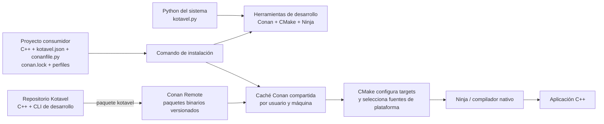

# Distribución y dependencias

Este documento define cómo se relacionan el código fuente de Kotavel, los
proyectos que lo consumen, las herramientas de desarrollo y los paquetes
binarios. La arquitectura de plataforma del núcleo se describe en el
[blueprint principal](README.md#frontera-de-plataforma-en-el-núcleo).

## Objetivos

- La aplicación final es C++ y no necesita Python para ejecutarse.
- Python es una herramienta para ejecutar los comandos de desarrollo de Kotavel.
- Los detalles del sistema operativo se seleccionan al configurar y compilar;
  el código común consume contratos C++.
- Conan reutiliza paquetes compatibles y compila desde código fuente cuando no
  existe un binario adecuado.
- Un proyecto consumidor conserva sus propias dependencias, configuración y
  lockfile, mientras que la máquina puede compartir descargas y herramientas.
- Los paquetes publicados se validan desde un consumidor independiente.

## Vista de la distribución



La aplicación compilada no depende del intérprete Python ni de la caché Conan.
Python, Conan, CMake y Ninja intervienen durante el desarrollo y la
construcción. El instalador de cada aplicación es una salida de su propio
proyecto; no centraliza ni selecciona varios productos.

## Responsabilidad de cada capa

| Capa | Responsabilidad |
| --- | --- |
| Python del sistema | Ejecutar `kotavel.py` y la CLI de desarrollo. No forma parte del runtime C++ distribuido. |
| CLI de Kotavel | Leer la configuración y el perfil, preparar el entorno de compilación y coordinar Conan, CMake y las pruebas solicitadas. |
| Proyecto consumidor | Declarar opciones, dependencias, perfiles y lockfile propios. |
| Conan | Resolver referencias, opciones y configuraciones binarias compatibles; instalar paquetes o construir los que falten. |
| Conan Remote | Distribuir paquetes precompilados y versionados. |
| Caché Conan local | Reutilizar paquetes y metadatos en la máquina del desarrollador. |
| CMake | Elegir targets y fuentes por sistema operativo, configurar enlaces y generar la compilación. |
| Adaptadores de plataforma | Implementar contratos C++ para Windows, Linux y macOS. |
| Compilador y Ninja | Crear los binarios nativos de Kotavel y del consumidor. |

## Estructura por ubicación

## Análisis de las dos estructuras propuestas

Los dos árboles resuelven problemas distintos y conviene mantenerlos
separados: `packages/` describe de dónde obtener bibliotecas de terceros; el
árbol `core/platform/bootstrap` describe cómo Kotavel separa la lógica común
de las implementaciones del sistema operativo.

### Paquetes de terceros

La propuesta inicial era:

```text
Kotavel/
├── CMakeLists.txt
├── src/
├── include/
├── packages/
│   ├── windows-x64-llvm-mingw/
│   │   ├── qt/
│   │   └── openssl/
│   ├── linux-x64/
│   │   ├── qt/
│   │   └── openssl/
│   └── macos-arm64/
│       ├── qt/
│       └── openssl/
└── .kotavel/
```

La intención —evitar compilar Qt y OpenSSL para cada proyecto y sistema— es
correcta. Mantener esos binarios versionados bajo `packages/` no escala bien:
se duplican versiones y configuraciones, el checkout crece, y un nombre de
carpeta no captura por sí solo compilador, ABI, runtime, opciones ni
dependencias transitivas. También habría que resolver manualmente qué paquete
es compatible con cada build.

Para Kotavel, Conan debe ser el almacén y resolver de esos paquetes. La forma
de alto nivel recomendada es:

```text
Kotavel/
├── CMakeLists.txt
├── cmake/                         Selección central de fuentes y targets
├── conanfile.py                   Dependencias y opciones del framework
├── conan.lock                     Resolución fijada cuando corresponda
├── profiles/                      Perfiles mantenidos por el framework
├── src/                            Código C++
├── include/                        API pública C++
├── tools/kotavel_cli/              Comandos de desarrollo
└── .github/workflows/              Construcción y verificación de paquetes

Máquina del desarrollador:
└── caché Conan compartida          Paquetes descargados o construidos

Conan Remote:
└── paquetes precompilados           Distribución entre máquinas y CI
```

`packages/` no forma parte del checkout con bibliotecas binarias por sistema.
Si en el futuro se requiere un SDK excepcional que Conan no pueda representar,
se trataría como una herramienta externa versionada y con manifiesto de hash,
origen y compatibilidad, no como una copia manual de Qt/OpenSSL por carpeta.
`.kotavel/` es estado generado del proyecto consumidor; el repositorio del
framework no debe usarlo como almacenamiento de dependencias compartidas.

### Núcleo, contratos y adaptadores de plataforma

La otra propuesta era:

```text
kotavel/
├── core/
│   ├── application/
│   ├── domain/
│   └── contracts/
│       ├── SystemPaths.hpp
│       ├── ProcessManager.hpp
│       ├── SystemMetrics.hpp
│       └── UrlSchemeRegistrar.hpp
├── platform/
│   ├── windows/
│   ├── linux/
│   └── macos/
└── bootstrap/
    └── PlatformBootstrap.cpp
```

Este patrón sí expresa la dirección arquitectónica adecuada: el núcleo depende
de contratos; los adaptadores implementan esos contratos; el bootstrap compone
la implementación de la plataforma elegida. La selección ocurre en CMake y la
aplicación puede reemplazar un provider cuando el contrato lo permita. El
núcleo no ramifica por sistema operativo durante cada operación.

Hay tres ajustes importantes:

1. **Ubicación física dentro del repositorio:** separar `core/` de `platform/`
   es una separación conceptual útil, pero en Kotavel las cabeceras públicas
   van bajo `include/kotavel/` y el código compilado bajo `src/`. Por eso la
   forma concreta debe ser `include/kotavel/contracts/` y
   `src/platform/{windows,linux,macos}/`, junto con `src/platform/posix/` para
   código común POSIX.
2. **La carpeta `domain/` no se agrega por defecto:** Kotavel es un framework;
   “dominio” puede confundirse con el dominio de negocio de cada aplicación.
   Solo se justifica si aparecen tipos o reglas estables del framework que no
   pertenecen a `foundation`, `http`, `desktop` ni otro módulo. El negocio del
   consumidor permanece en el proyecto consumidor.
3. **Los nombres de contratos expresan capacidades reales:** el ejemplo
   `ProcessManager`, `SystemMetrics` y `UrlSchemeRegistrar` es una propuesta,
   no una lista de APIs ya implementadas. Hoy existen `ProcessMetricsProvider`,
   `SystemPaths` y `RuntimePathResolver`. Un administrador de procesos y un
   registrador de esquemas URL se agregarían cuando haya casos de uso,
   semántica de error, ciclo de vida y pruebas definidos. `SystemMetrics` debe
   precisarse antes de usarse: puede significar métricas del proceso o métricas
   generales del host, que son contratos distintos.

El árbol recomendado conserva la organización modular que ya usa el repositorio;
`core` se entiende como responsabilidad lógica y no obliga a crear una carpeta
`src/core/` que duplique la división por módulos:

```text
Kotavel/
├── include/kotavel/
│   ├── foundation/                API pública del ciclo de vida
│   ├── contracts/                 Puertos públicos multiplataforma
│   ├── console/ http/ desktop/    Módulos públicos
│   └── ...
├── src/
│   ├── foundation/                Ciclo de vida y aplicación
│   ├── container/                 Registro y resolución de servicios
│   ├── diagnostics/                Errores y logging
│   ├── platform/
│   │   ├── windows/               Adaptadores Windows
│   │   ├── linux/                 Adaptadores Linux
│   │   ├── macos/                 Adaptadores macOS
│   │   └── posix/                 Implementación compartida POSIX
│   ├── http/ console/ desktop/     Implementaciones de módulos
│   └── ...
├── cmake/
│   └── KotavelPlatform.cmake      Selección de fuentes por plataforma
├── conanfile.py                  Dependencias del framework
└── tests/                         Pruebas unitarias e integración
```

`PlatformBootstrap.cpp` representa la responsabilidad de composición, no un
requisito de que exista un archivo con ese nombre exacto. En la implementación
actual esa función está repartida entre `src/platform/platform_service_provider.cpp`,
el runtime y la selección central de CMake. Conviene conservar un único punto
de composición lógico; se puede reunir en un archivo explícito si la cantidad
de servicios lo hace más fácil de mantener.

En resumen: se adopta el patrón de contratos, adaptadores y composición de la
segunda estructura, adaptado a la API pública y layout reales del repositorio.
Para la primera, se conserva el objetivo de reutilizar binarios, pero Conan
Remote y su caché reemplazan las carpetas `packages/<plataforma>/<biblioteca>`.

### Repositorio de Kotavel

```text
Kotavel/
├── include/kotavel/             Contratos y API C++ pública
├── src/platform/{windows,linux,macos}/ Implementaciones nativas
├── cmake/                       Selección central de plataforma
├── tools/kotavel_cli/           Comandos Python de desarrollo
├── conanfile.py                 Dependencias del framework
├── .github/workflows/           Construcción y verificación de paquetes
└── docs/blueprint/              Arquitectura objetivo y decisiones
```

El código C++ común no consulta repetidamente el sistema operativo. CMake
incluye una implementación por plataforma y el bootstrap registra sus
servicios. Los contratos públicos siguen siendo independientes del proveedor.

## Organización interna de una biblioteca

Una biblioteca de Kotavel debe separar el contrato público, la implementación
común, los adaptadores externos y las pruebas. Este árbol para un módulo futuro
`Cache` es un ejemplo de diseño; **no afirma que el módulo Cache ya exista**:

```text
include/kotavel/cache/
└── cache_store.hpp             Contrato público usado por el consumidor

src/cache/
└── cache_manager.cpp           Lógica común independiente del proveedor

adapters/cache/
├── memory/memory_cache.cpp     Adaptador simple o de pruebas
└── redis/redis_cache.cpp       Adaptador opcional para Redis

tests/unit/cache/
└── cache_manager_tests.cpp     Reglas de la lógica común

tests/integration/cache/
└── redis_cache_tests.cpp       Integración opcional con Redis
```

El contrato público no incluye headers de Redis, Qt ni otra biblioteca externa.
`Kotavel::Cache` sería un target opcional; la integración con Redis podría
publicarse en un target aparte, por ejemplo `Kotavel::CacheRedis`, que depende
de `Kotavel::Cache` y de la receta Conan correspondiente. Un consumidor sin
Redis no debería instalar ni enlazar esa dependencia. El adaptador de memoria
puede servir a pruebas o a usos explícitos, pero no debe convertirse
silenciosamente en backend de producción.

Los métodos pertenecen al contrato de la capacidad, no al proveedor. Una API
ilustrativa podría ser:

```cpp
#include <chrono>
#include <optional>
#include <string>
#include <string_view>

class CacheStore {
public:
    virtual ~CacheStore() = default;

    [[nodiscard]] virtual std::optional<std::string>
    get(std::string_view key) const = 0;

    virtual void put(std::string_view key,
                     std::string_view value,
                     std::chrono::seconds ttl) = 0;

    virtual bool erase(std::string_view key) = 0;
};
```

`get` representa un acierto con valor y un fallo de caché con `std::nullopt`;
`erase` indica si había un elemento que eliminar. El tipo concreto de error
para fallos del backend —excepciones o un resultado explícito— queda sujeto a
la decisión común sobre errores del blueprint; el ejemplo no fija todavía ese
contrato. Los nombres y el alcance de estos métodos son ilustrativos, no una
API pública aprobada.

Como referencia implementada hoy, las interfaces de plataforma siguen el
mismo límite: `ProcessMetricsProvider::read()` devuelve una muestra opcional;
`SystemPaths` ofrece `config_directory()`, `data_directory()` y
`cache_directory()`; `RuntimePathResolver::resolve()` obtiene las rutas de
recursos del ejecutable. Sus declaraciones están en
`include/kotavel/contracts/` y los adaptadores por sistema bajo
`src/platform/`. CMake compila la implementación seleccionada y el bootstrap
la registra. Así el consumidor de la biblioteca llama métodos C++ estables y
no selecciona Windows, Linux o macOS dentro de cada operación.

Regla de dependencias: los headers públicos solo requieren tipos estándar de
C++ o tipos propios de Kotavel. Las bibliotecas de terceros se enlazan en la
implementación concreta o en un target de adaptador opcional. Cada target
declara sus fuentes y dependencias explícitamente; no se añade una dependencia
al núcleo solo porque un módulo futuro la pueda usar.

### Proyecto consumidor

```text
MiAplicacion/
├── app/                         Código C++ de la aplicación
├── bootstrap/                   Composición y arranque del consumidor
├── config/                      Configuración compilada o de runtime
├── kotavel.py                   Entrada a las herramientas de Kotavel
├── kotavel.json                 Modo y opciones del consumidor
├── conanfile.py                 Dependencias propias y opciones
├── conan.lock                   Resolución fijada de dependencias
├── profiles/                    Perfiles propios, si se requieren
├── CMakePresets.json            Presets de configuración y build
└── .kotavel/                    Estado auxiliar de comandos del proyecto
```

El proyecto mantiene su código, configuración, manifiestos y lockfile. La
carpeta `.kotavel/` se reserva para estado auxiliar específico del proyecto;
no debe ser el hogar permanente del intérprete Python, herramientas comunes ni
la caché de paquetes compartida.

### Máquina del desarrollador

La estructura objetivo mantiene el intérprete seleccionado por el usuario y
los datos reutilizables fuera de cada checkout:

```text
Python del sistema o del usuario
~/.kotavel/
├── tools/                       Herramientas de desarrollo compartidas, si se aíslan
└── conan/                       Caché Conan compartida en macOS y Linux

%USERPROFILE%/.k/                Caché Conan en Windows
```

La CLI usa el Python disponible en el sistema. Si las herramientas Python
necesitan aislamiento, su entorno se comparte desde la carpeta de usuario; no
se crea uno por proyecto. Las herramientas nativas y los compiladores pueden
seguir siendo instalaciones administradas por el sistema operativo.

### Registro remoto

```text
Conan Remote
└── kotavel/<versión>#<revisión>
    └── package_id derivado del perfil, opciones y dependencias
```

Un remote proporciona artefactos reutilizables, no sustituye al repositorio ni
al lockfile del consumidor. La URL y credenciales son configuración externa;
no se guardan secretos en Git.

## Identidad y compatibilidad binaria

Un paquete binario se selecciona según la configuración completa que Conan usa
para calcular su identidad. Entre los factores relevantes están:

- sistema operativo y arquitectura;
- compilador y versión;
- ABI y runtime de C++;
- configuración Debug o Release;
- opciones del paquete y de sus dependencias;
- versiones y revisiones del grafo Conan.

Nombres descriptivos como `macos-arm64-appleclang-release` ayudan a los
desarrolladores, pero no deben reemplazar el `package_id` de Conan ni prometer
compatibilidad entre toolchains distintos. Los paquetes se construyen para
perfiles definidos y se prueban desde un proyecto consumidor limpio.

## Flujo de instalación y compilación

1. El usuario ejecuta `python3 kotavel.py install` con el Python seleccionado
   en su sistema.
2. La CLI lee la configuración y el perfil efectivo del consumidor.
3. Conan resuelve el lockfile y consulta el remote configurado.
4. Los paquetes compatibles se obtienen del remote o de la caché local. Con
   `--build=missing`, Conan compila las variantes ausentes.
5. La CLI prepara CMake con las dependencias y opciones del proyecto.
6. CMake selecciona las fuentes de plataforma y genera los targets.
7. Ninja y el compilador crean la aplicación C++.
8. Las pruebas y el empaquetado se ejecutan como pasos explícitos del
   consumidor.

`install` prepara dependencias; no debe confundirse con la distribución de la
aplicación. El paquete del framework y el instalador de una aplicación tienen
ciclos de publicación separados.

## Cachés y transición

La caché de paquetes reduce descargas y compilaciones repetidas. En macOS y
Linux el valor predeterminado para proyectos nuevos es `~/.kotavel/conan`; en
Windows es `%USERPROFILE%/.k`, donde la ruta corta evita problemas de longitud
con Qt. `KOTAVEL_CONAN_HOME` permite elegir otra carpeta. Un proyecto que ya
tenga `.kotavel/conan` conserva esa caché local como compatibilidad; quitarla
no migra sus paquetes, y la próxima instalación usará el valor compartido.

Hay una diferencia que debe cerrarse antes de considerar terminada la
distribución de herramientas: la implementación actual crea
`.kotavel/tools/python` para instalar Conan, CMake y Ninja. Esto no agrega
Python al ejecutable C++, pero sí crea un entorno Python por proyecto y no
coincide con la estructura objetivo descrita aquí. La CLI debe migrar esas
herramientas a una ubicación compartida de usuario o usar instalaciones
globales existentes, sin borrar los datos de herramientas de otros proyectos.
Hasta que ese cambio se implemente, borrar `.kotavel/` provoca que `install`
vuelva a crear el entorno local.

## Publicación y verificación

El workflow manual de Conan construye perfiles Release para macOS, Linux y
Windows, publica los paquetes al remote configurado y después prueba su
instalación con `--build=never` desde runners limpios. Puede variar las
features opcionales de HTTP y desktop. Una publicación solo se considera
verificada cuando el remote está configurado, la subida termina y el job de
consumidor instala y enlaza el paquete.

La automatización no demuestra por sí sola compatibilidad con toda versión de
compilador, arquitectura u opción. La matriz publicada y los perfiles
soportados deben documentarse como una lista explícita y mantenerse junto con
las recetas Conan y los presets CMake.

## Estado y decisiones pendientes

| Área | Estado |
| --- | --- |
| Contratos C++ para métricas, rutas del sistema y recursos runtime | Implementados con selección de adaptadores desde CMake. |
| Caché Conan compartida en proyectos nuevos | Implementada; proyectos con caché local conservan compatibilidad y Windows usa una ruta corta. |
| Configuración opcional de Conan Remote | Implementada mediante variables de entorno. La URL y credenciales reales las configura quien administra el remote. |
| Workflow multiplataforma para construir y verificar paquetes | Preparado; la publicación real requiere un remote y secretos configurados. |
| Entorno local de herramientas Python fuera del checkout | Pendiente: actualmente `.kotavel/tools/python` se crea dentro de cada proyecto. |
| Matriz nativa Windows/Linux | Requiere resultados de CI; las pruebas locales de macOS no certifican esas plataformas. |
| Compatibilidad y soporte de cada perfil publicado | Debe fijarse y documentarse a partir de builds verificados. |

## Criterios de aceptación

- Un proyecto nuevo ejecuta la CLI con Python del usuario y no crea un entorno
  Python dentro del checkout.
- Las herramientas compartidas se instalan o reutilizan de forma segura entre
  proyectos y sus versiones son verificables.
- Instalar desde un remote poblado con `--build=never` descarga paquetes
  compatibles y compila un consumidor independiente.
- Una caché vacía con `--build=missing` produce un paquete funcional o informa
  con claridad qué perfil o recurso falta.
- Un cambio de ABI, opción o dependencia no reutiliza un binario incompatible.
- Las builds y pruebas pasan para cada sistema y perfil declarado como
  soportado; las plataformas no probadas quedan marcadas como pendientes.
- El ejecutable y el instalador de la aplicación funcionan sin Python ni Conan
  en runtime, salvo que la aplicación declare explícitamente otra necesidad.
